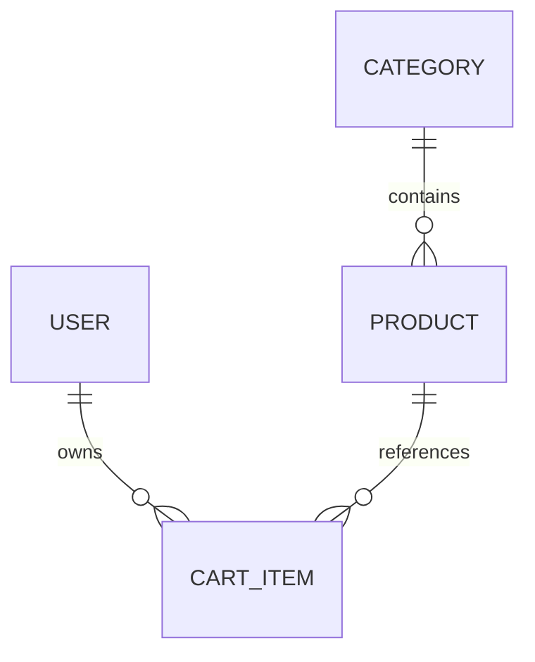
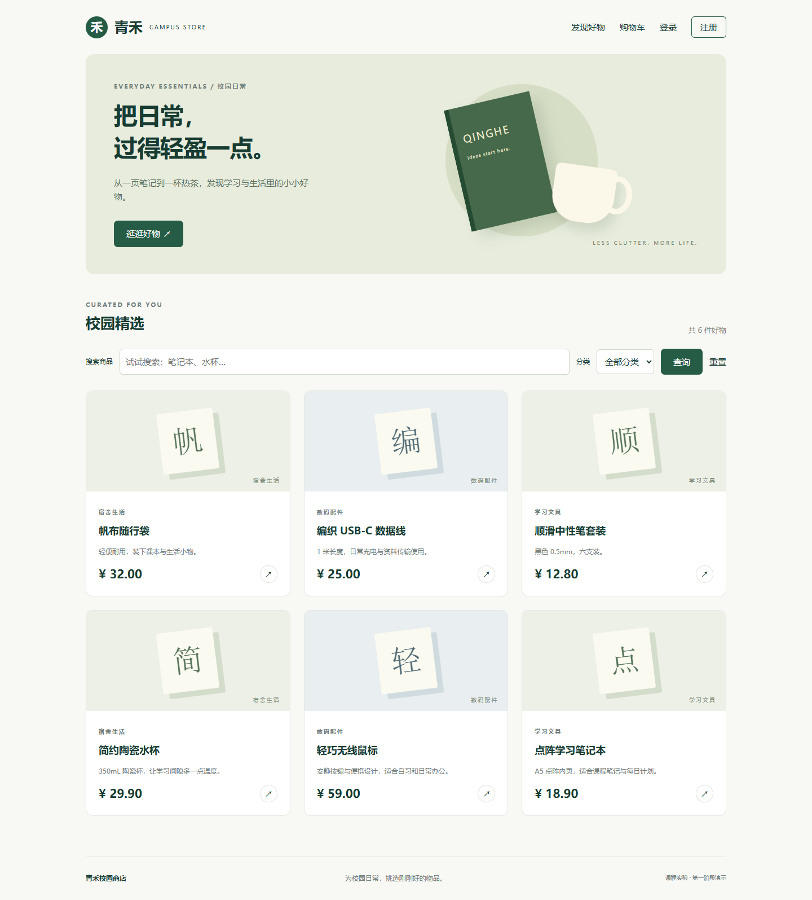
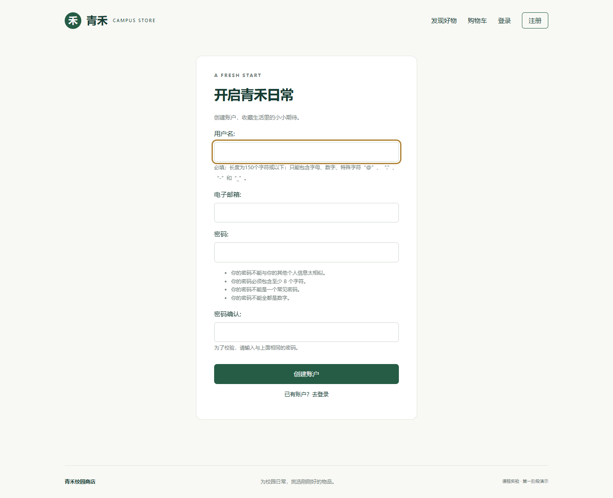
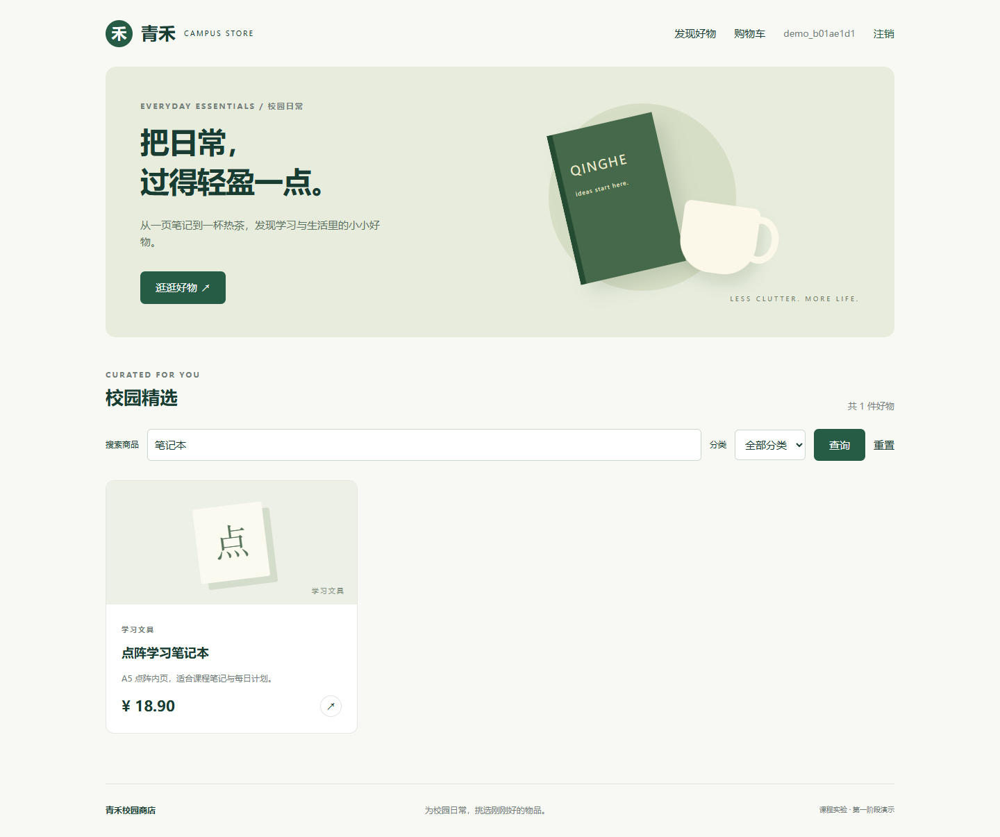
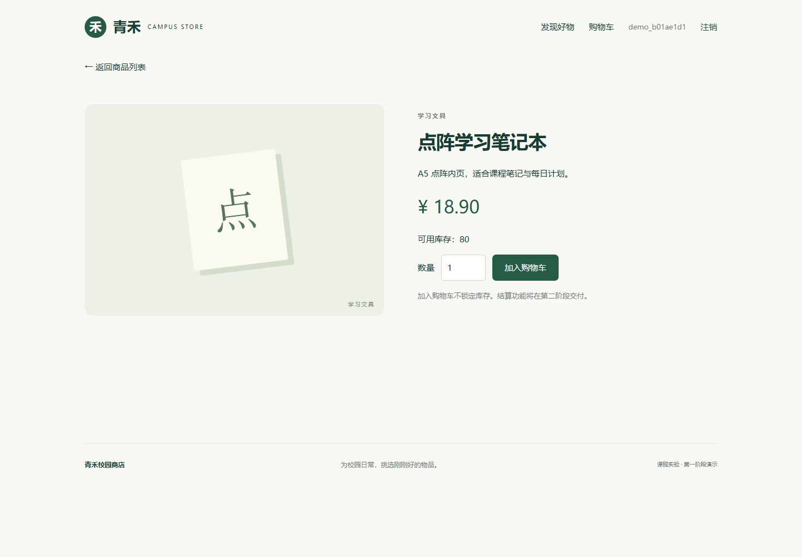
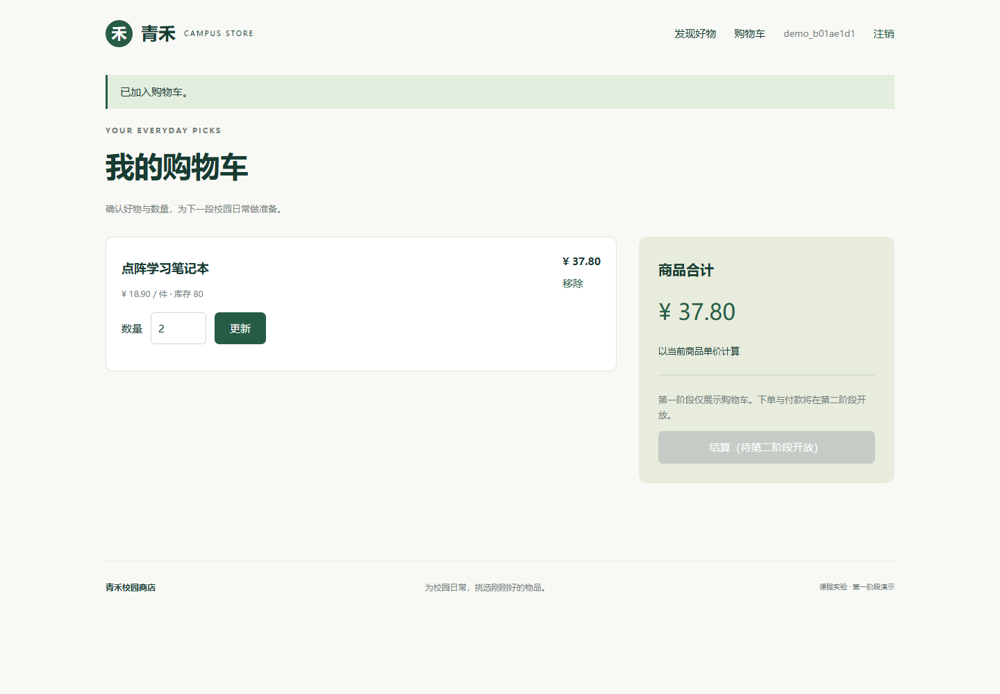
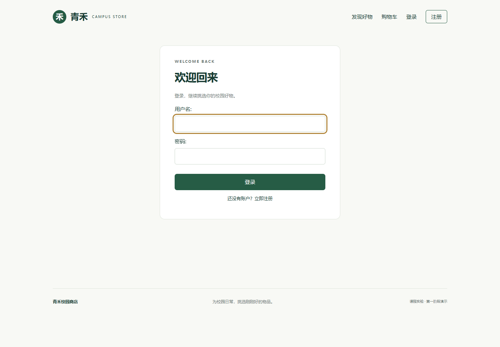
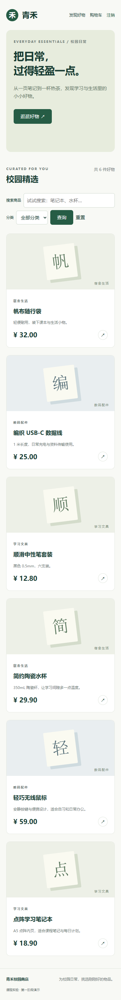

# 第一阶段交付文档：需求设计与基础购物功能

实验题目：设计并实现一个在线购物网站  
项目名称：青禾校园商店  
实际执行日期：2026 年 10 月 25 日启动，10 月 26 日整理交付（北京时间）  
阶段：1 / 3，用户要求提前立即执行  
学号、姓名：待填写  
源码仓库、线上地址：待实际创建或部署后填写

## 一、实验要求与阶段范围

依据根目录 `ex.html` 的“实验题目”“基本功能要求”“考核依据”编写。完整实验要求顾客注册、登录、注销，浏览和查询商品，加入购物车、付款、发货邮件，订单状态及历史；销售端需要商品目录增删改查、订单管理和销售统计；最终需要代码、设计说明、功能测试、详细部署步骤与截图。

原始材料还要求代码仓库可访问，报告写明网站地址及测试账户，从提交报告之日起三个月内可通过校园网访问。报告提交文件名为“学号_姓名.doc”或“学号_姓名.pdf”；课程指定模板来自 QQ 群共享文件夹，当前未提供，本阶段使用通用结构，尚非按课程模板排版的最终报告。

第一阶段完成：需求分析、技术方案、数据库模型及迁移、注册登录注销、商品列表/搜索/分类/分页/详情、购物车增改删与合计、基础商品管理后台、测试和运行截图。

第二阶段完成：订单、付款、邮件、订单历史与状态、订单后台及统计。第三阶段完成：整体验证、最终报告与阿里云部署文件和手册。本阶段结算入口明确禁用，尚未上线，不能作为完整实验提交。

## 二、设计思路

采用 Django 单体应用与服务端模板。用户请求先经 URL 路由进入视图，表单做输入校验，ORM 访问数据库，模板输出中文页面。统一会话认证、CSRF 防护和后台权限，减少前后端分离带来的部署复杂度，适合课程演示和单台 ECS 部署。

目标数据库为 MySQL；本阶段本机没有 MySQL 服务，实际运行使用 SQLite。两种配置共用同一套 ORM 模型和迁移；生产配置强制使用 MySQL。应用没有把 SQLite 测试等同于 MySQL 并发验证。

视觉主题为校园用品商店，使用绿色与米白色、中文导航和响应式卡片。插画与商品卡片由 CSS 和文字绘制，不依赖第三方图片或 CDN，不会将随机网络图片误作商品实物。

权限分为匿名访客、登录顾客和管理员。匿名用户可浏览、搜索、注册和登录；顾客只可访问自己的购物车；管理员通过 Django Admin 管理分类与商品，普通顾客不能进入后台。

## 三、数据库设计

已创建以下实体，另有 Django 管理的会话、权限和后台日志表：

- `auth_user`：Django 用户表，保存唯一用户名、哈希密码、电子邮箱、后台权限标志。电子邮箱为必填，但本阶段未做邮箱验证，也未限制邮箱全局唯一。
- `shop_category`：`id`、唯一分类名 `name`。
- `shop_product`：分类外键、商品名、描述、`Decimal(10,2)` 单价、非负库存、上架标记、创建和更新时间；单价数据库约束必须大于零。
- `shop_cartitem`：用户外键、商品外键、正整数数量；用户和商品组合唯一，避免同一用户重复行。

关系：分类一对多商品；用户一对多购物车项；商品一对多购物车项。删除分类使用 `PROTECT` 防止误删关联商品；删除商品会删除关联购物车项，商品下架则保留购物车项并显示下架提示。



本阶段尚未建立订单和支付表。后续订单项需要保存成交时的商品名称、单价和数量快照，避免修改商品后影响历史订单；付款需要独立交易号和幂等约束。

迁移文件为 `shop/migrations/0001_initial.py`，不是仅提供建表说明。金额使用 Decimal 计算，避免二进制浮点误差；购物车合计由服务端根据数据库价格计算，不接受浏览器传入价格。

## 四、代码实现说明

`config/settings.py` 加载环境变量，包含数据库切换、密码规则、Cookie 和主机配置。`.env`、数据库文件和虚拟环境不提交 GitHub；`.env.example` 仅供开发配置参考。

`shop/forms.py` 的注册表单继承 `UserCreationForm`，复用用户名、密码强度及重复密码校验。注册成功后自动登录，Django 保存哈希密码。登录使用框架自带 `LoginView`；注销仅支持带 CSRF 令牌的 POST。

`shop/views.py` 的商品查询只展示已上架商品，按名称或描述模糊搜索，可按分类筛选，每页 9 件。分类参数检查字符和长度，防止非法输入导致服务端异常；模板自动转义用户和商品文字。

购物车增改删入口均要求登录和 POST。所有购物车对象查询包含 `user=request.user`，即使用户猜中别人的购物车项 ID，也返回 404。数量须为 1 至 999 的整数，加入购物车合并同商品数量，不能超过当前库存。更新前重新检查商品是否上架和库存是否足够。

加入购物车的关键流程：

```python
with transaction.atomic():
    product = get_object_or_404(
        Product.objects.select_for_update(), pk=pk, is_active=True
    )
    item = CartItem.objects.filter(user=request.user, product=product).first()
    quantity = (item.quantity if item else 0) + form.cleaned_data["quantity"]
    if quantity > min(product.stock, 999):
        messages.error(request, "加入失败：超过可用库存或购物车数量上限。")
    # 合法时新增或更新购物车项，具体代码见 shop/views.py。
```

MySQL 下商品行锁用于串行化同一商品的购物车修改；SQLite 不支持同等行锁语义，因此本阶段不能证明 MySQL 并发行为。购物车不预扣或保留库存，第二阶段下单时必须重新检查并原子扣减。

`shop/admin.py` 注册分类与商品，提供商品新增、修改、删除、搜索及上下架筛选；管理员账户需运行 `createsuperuser` 自行创建，不提供公开默认管理员密码。

`shop/management/commands/seed_demo.py` 创建 3 个分类、6 件示例商品，可重复执行且不覆盖已有商品；不创建账户。完整源码在根目录，使用方法见 README。

## 五、本地运行步骤

以下命令在项目根目录 PowerShell 中执行；需要已安装 Python 3.12：

```powershell
py -3.12 -m venv .venv
.\.venv\Scripts\python.exe -m pip install -r requirements.txt
Copy-Item .env.example .env
.\.venv\Scripts\python.exe manage.py migrate
.\.venv\Scripts\python.exe manage.py seed_demo
.\.venv\Scripts\python.exe manage.py runserver 127.0.0.1:8000
```

打开 `http://127.0.0.1:8000/`，注册账户，搜索“笔记本”，进入详情页并加入购物车。本次依赖安装在默认源超时后使用了阿里云 PyPI 镜像；版本已锁定到 `requirements.txt`。本次 Python 为 3.12.7，Django 为 5.2.18。

后台管理：执行 `.\.venv\Scripts\python.exe manage.py createsuperuser`，访问 `/admin/`。MySQL 建库、配置切换和 Linux 安装步骤见根目录 README。本阶段没有 MySQL 服务，不提供虚构数据库连接截图。

## 六、功能测试与实际结果

在本地 SQLite 测试库运行 `manage.py test --verbosity 2`：**20 项测试全部通过**，耗时 2.567 秒。原始输出保存在本目录 `test-results.txt`。

覆盖内容包括：成功注册且密码哈希存储、重复用户名/非法邮箱拒绝、弱密码拒绝、错误及正确密码登录、安全重定向、POST 注销、商品查询及下架隐藏、非法分类输入、分页、未登录购物车跳转、同商品合并及 Decimal 合计、非法/超库存数量拒绝、零库存拒绝、购物车增改删、跨用户数据隔离、请求方法与 CSRF 防护、商品下架后的数量更新拒绝、数据库唯一性和正值约束、HTML 转义、普通用户后台隔离。

另外实际执行了数据库迁移、示例数据导入、`manage.py check` 和 `makemigrations --check --dry-run`，均成功，未发现待生成迁移。

真实 Edge 浏览器冒烟测试完成：注册 → 查询 → 详情 → 加入 2 件 → 合计 37.80 元 → 更新为 3 件 → 合计 56.70 元 → 移除 → 注销 → 重新登录。随后检查 390 像素宽手机视口，无横向溢出，未捕获前端页面异常。脚本在 `scripts/capture-stage1.cjs`，执行摘要在本目录 `browser-results.txt`。

GitHub Actions 文件提供 SQLite 与 MySQL 两组检查。当前尚未推送 GitHub，也未执行远程流水线；本地 20 项通过不代表远程 CI 或 MySQL 实测通过。尚无订单与支付并发测试，这属于第二阶段。

## 七、真实运行截图

以下均为本次本地运行页面，非阿里云线上页面。截图脚本使用随机演示账户，不暴露登录密码。

### 1. 商品首页



### 2. 注册表单



### 3. 查询结果



### 4. 商品详情



### 5. 购物车



### 6. 登录页面



### 7. 手机页面



## 八、GitHub 交付与部署进度

当前已提供适合 GitHub 的源码结构、README、MIT 许可证、依赖锁定、迁移、忽略规则、环境样例和 CI。源码尚未发布到 GitHub，仓库地址待填写。原始课程文件保留其版权，不属于原创应用代码的 MIT 授权范围。

第一阶段不进行云端上线。阿里云完整部署安排在第三阶段，预计使用 ECS、MySQL、应用服务器、Nginx 和 HTTPS；届时核对阿里云官方文档，提供明确命令和检查步骤。不会把开发服务器 `runserver` 当作正式部署方式。

第二阶段需新增订单、支付、邮件和销售统计。第三阶段需补齐最终测试、生产配置、备份恢复、部署截图、课程模板和真实访问信息。用户没有提供云资源时，线上登录、支付平台和 SMTP 的实际接通结果必须标记为待验证。

## 九、参考资料

- [Django 5.2 认证系统](https://docs.djangoproject.com/en/5.2/topics/auth/default/)
- [Django 5.2 MySQL 说明](https://docs.djangoproject.com/en/5.2/ref/databases/#mysql-notes)
- 原始实验要求：根目录 `ex.html` 第 2—6 页对应的实验说明。
