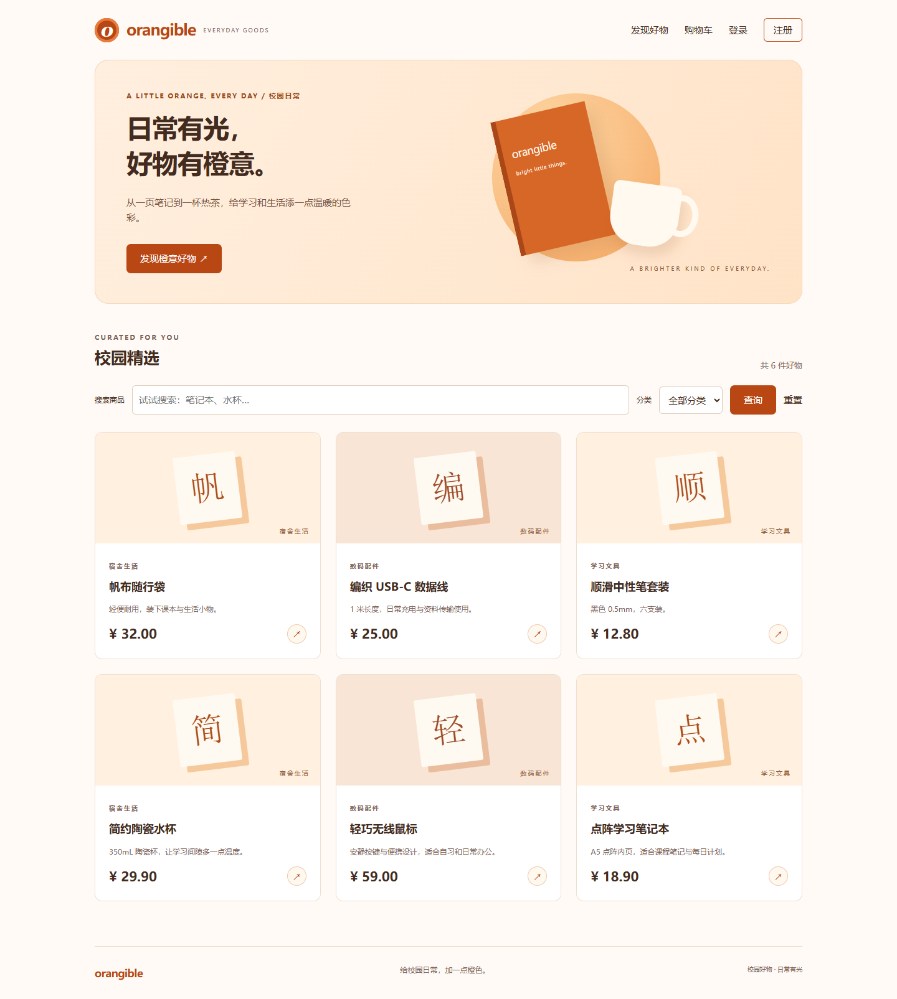

# orangible 品牌与界面调整

日期：2026-10-27。作为第二阶段上传前的界面修改记录，不表示订单和支付等第二阶段业务已完成。

网站名称统一为 `orangible`，前台导航、页脚、浏览器标题、注册提示、注册页面和后台品牌名称均已替换。主色为 `#b94713`，辅以奶油白、浅杏色及深棕文字。首页使用橙色渐变、暖色笔记本与水杯插画，商品卡片、按钮、输入边框、购物车合计区域和认证页面统一配色；后台浅色主题同步使用橙色。保留键盘焦点样式，并为减少动画偏好关闭卡片动效。

实际浏览器回归已通过：品牌标题与橙色按钮检查、注册、查询、详情、加入购物车、更新数量、移除、注销、重新登录；1440 像素桌面与 390 像素手机视口均已截图，手机无横向溢出，未捕获页面异常。执行脚本：`scripts/capture-branding.cjs`，输出记录：`branding/browser-results.txt`。

新证据保存到本阶段 `branding/screenshots/`，第一阶段文档和旧截图保留。当前修改仅在本地，按用户要求与第二阶段一起上传到已有 GitHub 仓库。

其他截图：`02-register.png`、`03-search.png`、`04-detail.png`、`05-cart.png`、`06-login.png`、`07-mobile.png`。
