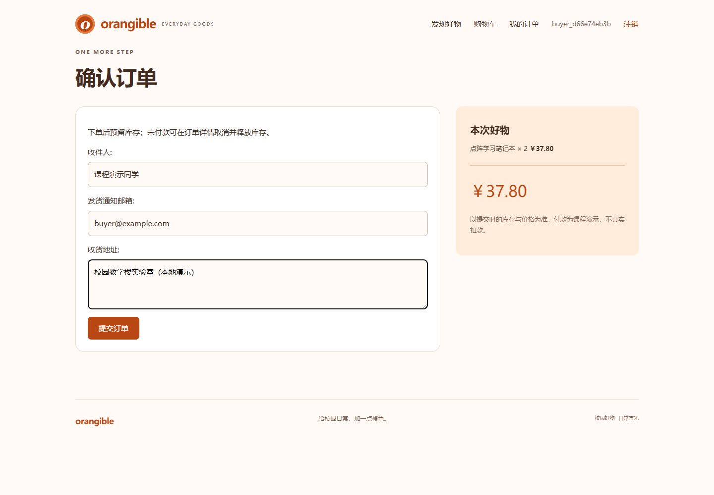
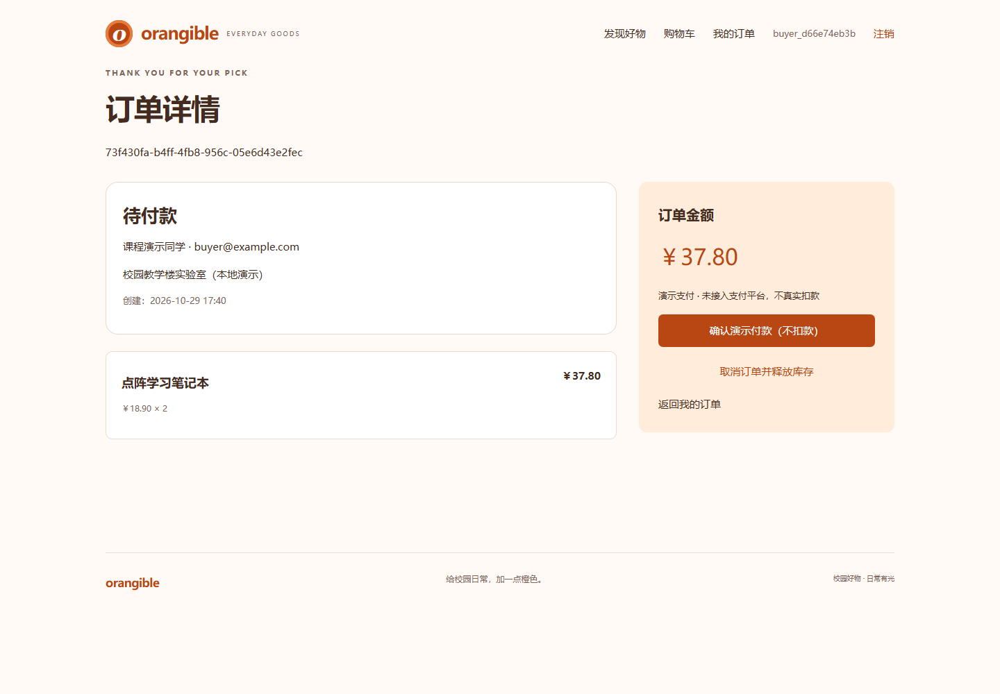
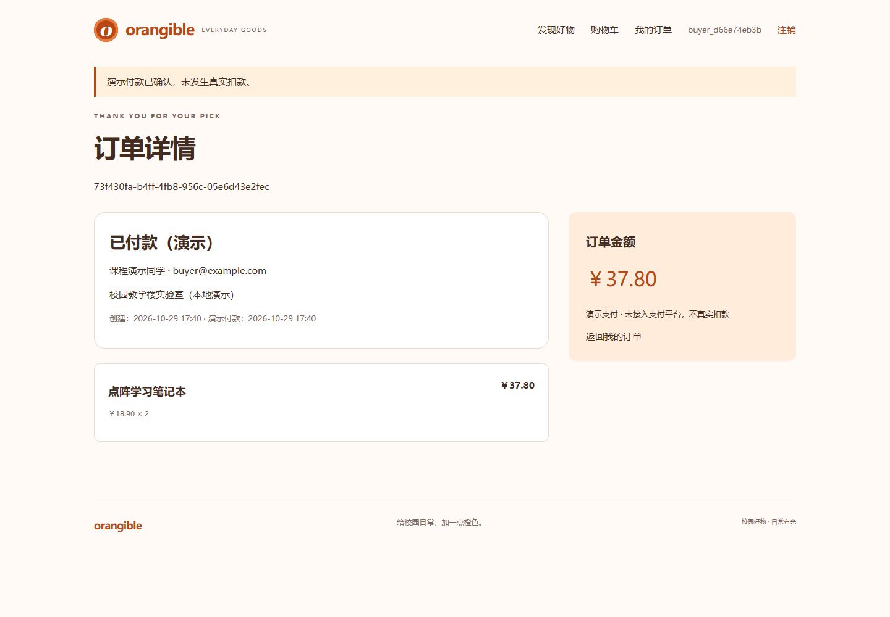
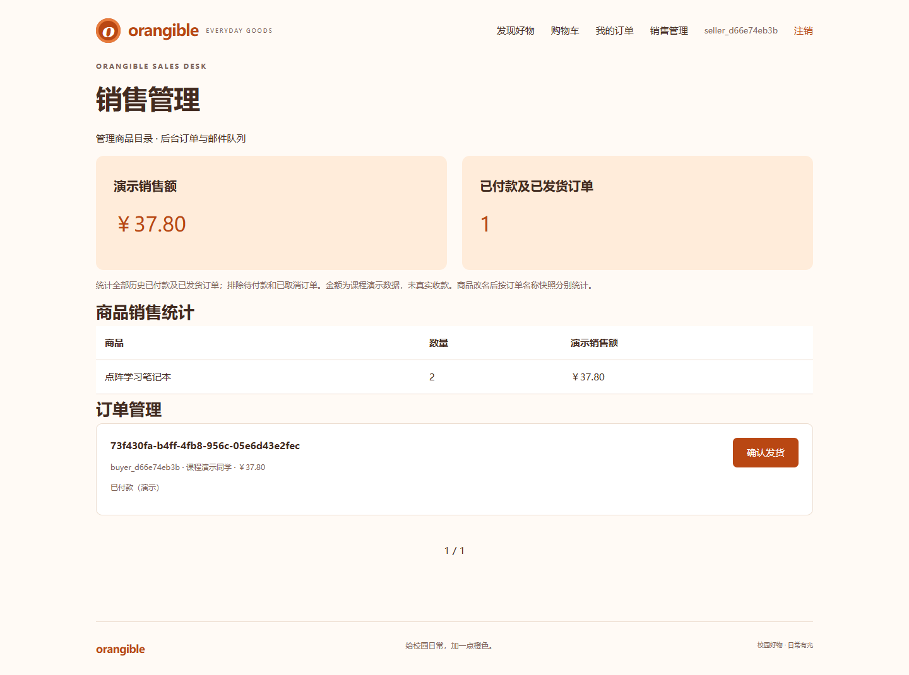
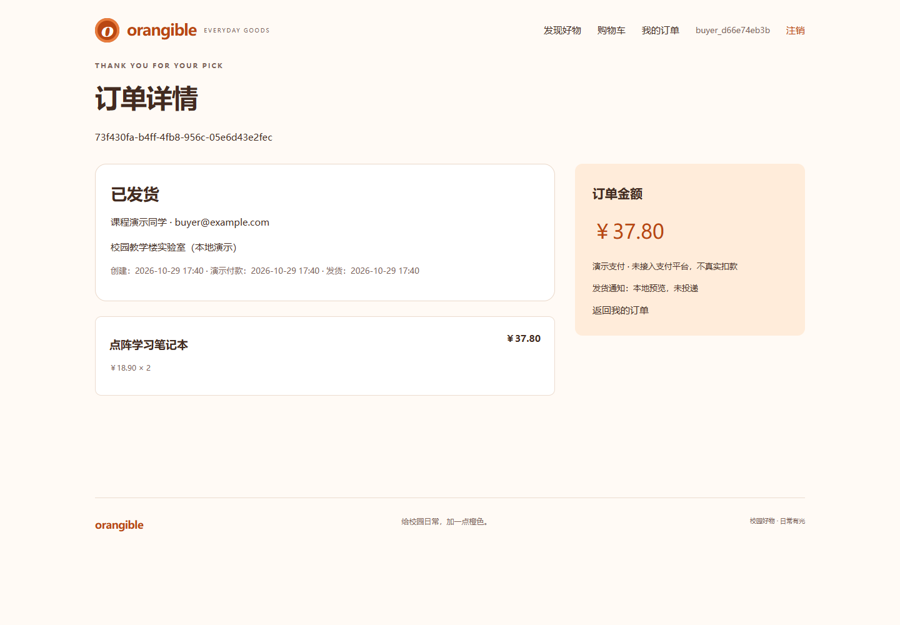
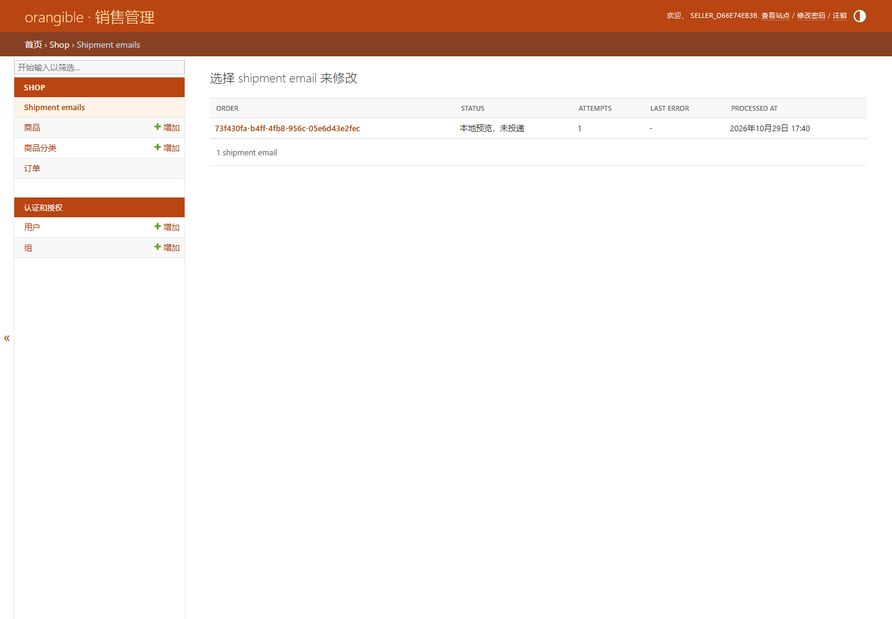
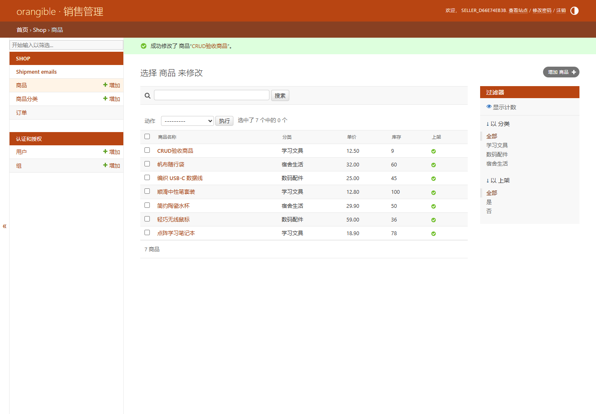
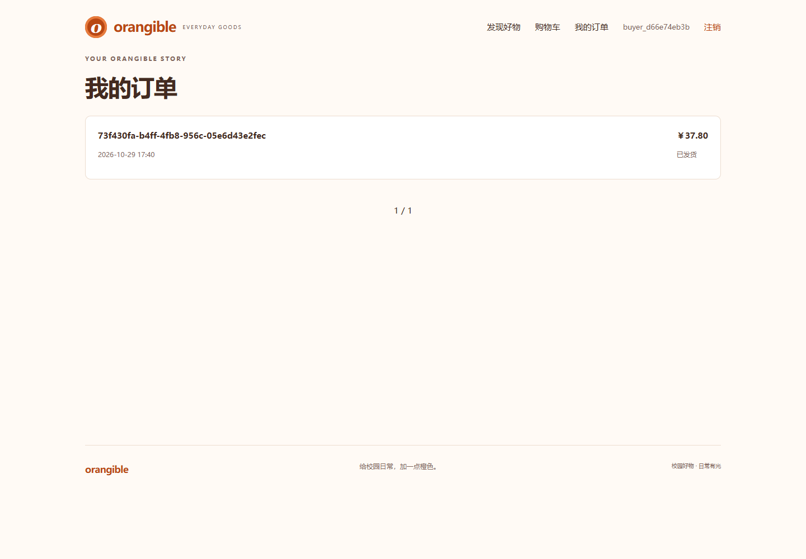
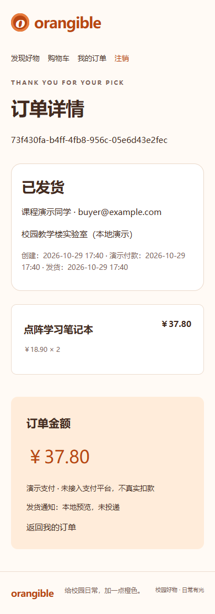

# orangible 在线购物网站 · 第二阶段交付文档

执行日期：2026-10-29（北京时间）。本阶段交付业务闭环及独立测试证据，第一阶段报告、截图保持原样。

## 实验题目与要求

设计并实现在线购物网站。顾客完成注册、登录、注销、浏览查询、购物车、下单付款、发货邮件和订单历史；销售人员维护商品、订单并查看销售统计。技术栈为 Django、MySQL、服务端模板，品牌为 orangible，沿用橙色视觉。

当前工作区未找到原始 `ex.html`，本阶段依据第一阶段已提取要求及 `docs/PROGRESS.md` 延续开发，不能声称重新读取了原文件。已知额外考核项保留至最终报告：代码仓库、真实网站地址、测试账户；提交后三个月校园网可访问；姓名学号待填写。QQ群报告模板未提供，采用通用实验报告结构。

## 设计思路

购物车不预占库存，下单时才预留。状态流转为“待付款 → 已付款（演示） → 已发货”，以及“待付款 → 已取消”。已取消订单不能付款，已付款订单不能通过当前取消接口退单，未付款不能发货。重复下单返回同一订单，重复付款不重写付款时间，重复取消只归还一次库存，重复发货只建立一个通知任务。

事务服务位于 `shop/order_services.py`。购物车变更和下单首先锁当前用户行；下单按商品主键升序执行 `select_for_update()`，以数据库当前价格、库存生成订单和明细，库存扣减另有条件 UPDATE 防护。任何商品不足时整个事务回滚。取消采用相同用户/商品锁顺序；付款和发货锁订单行。SQLite 只承担本地预览，MySQL/InnoDB 承担生产行锁。本阶段已用真实 MySQL 并行连接验证竞争场景。

订单明细保存商品名、单价、数量快照，后续改价不影响历史订单。下单令牌为会话内生成的 UUID，并在数据库中唯一；表单重试保留最近 8 个令牌。顾客订单查询、付款、取消均限定当前用户。所有状态写操作使用 POST + CSRF。

发货状态与 `ShipmentEmail` 任务在同一事务提交。管理命令独立处理通知，失败记录异常类型并可重试，不把邮件服务故障回滚成“未发货”。邮件投递具有外部副作用：进程在 SMTP 接受之后、记录状态之前崩溃可能导致重发，不能保证跨 SMTP 的严格仅一次投递。

## 数据库与代码

新增迁移：`shop/migrations/0002_order_orderitem_shipmentemail_and_more.py`。

- `Order`：UUID 主键、唯一结算令牌、所属用户、收件信息快照、金额、状态和时间。约束保证正金额及有效状态。
- `OrderItem`：关联订单和商品、名称/价格快照、正数量；被订单引用的商品不能物理删除，可下架保留历史。
- `ShipmentEmail`：每订单唯一通知任务，状态、尝试次数、处理时间和异常类型。
- `shop/forms.py`：收货表单，验证 UUID、邮箱、姓名和地址长度。
- `shop/views.py`、`shop/urls.py`：结算、订单历史/详情、演示付款、取消、销售面板和发货。
- `shop/admin.py`：商品 CRUD、只读订单及发货动作、邮件队列状态。禁止直接编辑订单金额/状态或删除订单。
- `templates/shop/checkout.html`、`orders.html`、`order_detail.html`、`sales.html`：实际可操作页面。
- `shop/test_orders.py`：事务回滚、库存、权限、幂等、统计及 MySQL 并发测试。

销售面板要求 staff 且具备 `shop.view_order`；发货另需 `shop.change_order`。商品权限由 Django Admin 单独控制。统计全历史已付款及已发货订单，排除待付款和取消订单；按订单名称快照汇总商品数量和金额，改名可能产生分组。

## 本地运行和操作步骤

在项目根目录运行：

```powershell
.\.venv\Scripts\python.exe manage.py migrate
.\.venv\Scripts\python.exe manage.py seed_demo
.\.venv\Scripts\python.exe manage.py createsuperuser
.\.venv\Scripts\python.exe manage.py runserver 127.0.0.1:8000
```

1. 注册顾客，选择商品加入购物车，点击“去结算”，填写收件人、邮箱、地址并提交。
2. 订单详情显示金额和待付款状态。点击“确认演示付款（不扣款）”完成本地演示；也可在付款前取消，释放预留库存。
3. 管理员登录 `/admin/` 维护商品，登录 `/sales/` 查看统计、订单并确认发货。后台订单列表也支持发货动作。
4. 运行通知处理命令，随后刷新订单详情和邮件队列查看结果：

```powershell
.\.venv\Scripts\python.exe manage.py send_shipment_emails
```

当前没有支付平台沙箱凭据，采用明确标注的演示支付；不是平台沙箱联调，更未真实收款。配置 `DEMO_PAYMENT_ENABLED=false` 可关闭演示付款。将来接入支付平台必须增加服务端验签、金额/商户/订单核对及支付流水唯一约束，不能把浏览器跳转或此演示接口当作支付回调。

## SMTP 配置与边界

默认 console 后端只在终端输出预览，队列状态为“本地预览，未投递”。`.env.example` 提供全部变量，真实值只保存在本地 `.env`：

```dotenv
EMAIL_BACKEND=django.core.mail.backends.smtp.EmailBackend
EMAIL_HOST=填写实际SMTP主机
EMAIL_PORT=587
EMAIL_HOST_USER=填写SMTP用户名
EMAIL_HOST_PASSWORD=填写SMTP授权码
EMAIL_USE_TLS=true
EMAIL_USE_SSL=false
DEFAULT_FROM_EMAIL=填写获授权的发件邮箱
```

若供应商使用 465，按其要求改为 SSL 并关闭 TLS。SMTP 成功只记录“SMTP 已接受，未确认收件”。本阶段未使用真实 SMTP 凭据，未测试真实邮件收件；SMTP 成功分支只用 mock 验证状态语义。失败任务再次运行命令会重试；默认每次最多 100 条。预览完成任务不会因更换后端自动重发，正式联调请用新测试订单。第三阶段提供定时运行命令的部署配置。

## 功能测试与证据

`test-results.txt` 是 SQLite 回归日志；`mysql-test-results.txt` 是独立 MySQL 8.0.45 实测日志。MySQL 8.4 仍是部署目标，不能将 8.0.45 的本地结果写成 8.4 已验证。

- SQLite：39 项中 36 项通过，3 项 MySQL 并发用例明确跳过。
- MySQL 8.0.45：39 项全部通过，包含两买家竞争最后一件商品、相同令牌并行下单、付款与取消同时发生。
- 权限：跨顾客读/付/取消返回 404；无销售权限访问或发货返回 403；修改接口检查 POST 和 CSRF。
- 数据正确性：库存不足整单回滚、价格快照、重复付款/取消/发货、关闭演示支付、邮件失败重试、统计排除未付款与取消订单。
- 浏览器验收记录在 `browser-results.txt`：真实本地页面操作，独立 SQLite 库和随机测试账号；截图不是设计稿。脚本 `scripts/capture-stage2.cjs` 可复现。

MySQL 可复现测试（需要本机 mysqld 和 mysqlclient，不使用现有系统数据库）：

```powershell
.\.venv\Scripts\python.exe scripts/test-mysql-local.py --mysqld 'D:\MySQL\MySQL Server 8.0\bin\mysqld.exe'
```

脚本新建独立临时数据目录，实例仅监听本机端口 13316，使用随机临时密码，测试后关闭并清理目录。无需在聊天中提供现有数据库密码。

### 运行截图











## 当前限制与下一阶段

未上线阿里云，当前没有真实网站地址或公开测试账户；未购买资源。订单暂不设自动过期，未付款预留库存需顾客主动取消，课程演示注意及时释放。未实现真实支付、退款、物流服务对接。邮件内容说明课程演示，发货状态由实验管理员维护。

第三阶段于 2026-11-01 执行：端到端复核、完整实验报告、Docker/Compose/Nginx/HTTPS、MySQL 部署与备份排错、阿里云官方文档核对，以及待填写的线上信息。保持提交后三个月校园网可访问的要求，当前暂定提交日 2026-12-08，对应维护至 2027-03-08。
