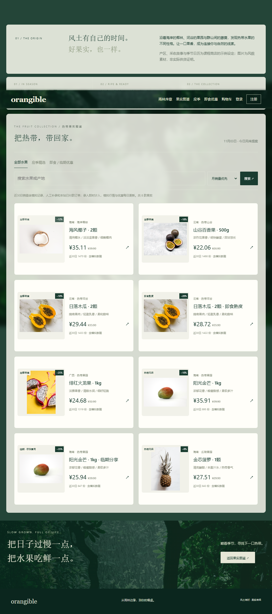
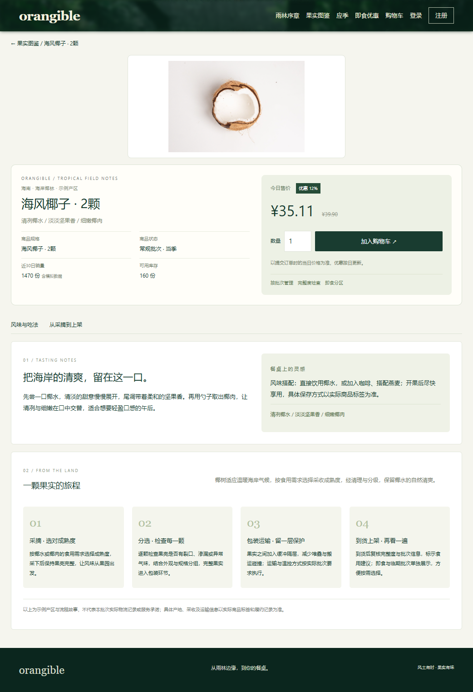
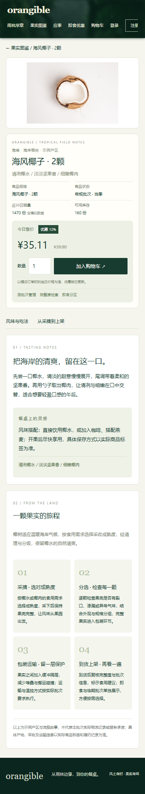

# orangible 在线购物网站实验报告

姓名：待填写；学号：待填写；课程：Internet Application；整理日期：2026-11-02。
代码仓库：https://github.com/Cherable/CS-Internet-Application-Exp
网站地址：尚未部署；测试账户：尚未配置线上测试账户。

## 题目和要求

实现顾客注册、登录、注销；商品浏览查询；购物车、付款、发货通知；订单状态和历史；销售管理的商品增删改查、订单管理、统计报表。数据库采用 MySQL，页面采用 Django 服务端模板与 orangible 雨林纪录片主题。

系统面向热带水果购物场景，支持顾客购物和销售管理两类业务。应用采用分层结构，将页面展示、输入校验、业务事务和数据持久化分别实现。

## 设计思路与数据库

浏览器经 Nginx HTTPS 到 Gunicorn/Django，Django ORM 操作 MySQL。认证使用 Django 用户和密码哈希；普通顾客仅访问自己的购物车和订单；staff 加模型权限访问销售功能。

Category 保存分类；Product 保存名称、价格、库存和上架状态；CartItem 保存用户/商品唯一行及正数量。Order 保存用户、唯一 UUID 结算令牌、金额和收货快照；OrderItem 保存名称与价格快照；ShipmentEmail 保存每订单唯一的通知任务与尝试结果。迁移见 shop/migrations/0001_initial.py、0002_order_orderitem_shipmentemail_and_more.py。

购物车不占库存。下单事务先锁用户，再按商品主键锁库存，复查库存、计算服务端 Decimal 总价、生成明细、条件扣库存并清购物车；失败整单回滚。唯一令牌和用户锁控制重复提交。待付款可取消并仅归还一次库存；演示付款、发货均锁订单并检查状态。邮件发送异步于订单事务，由定时管理命令处理。

## 系统实现

完整代码在仓库中：shop/models.py（模型/约束）、forms.py（输入校验）、views.py 和 urls.py（认证和页面接口）、order_services.py（事务及状态转换）、admin.py（商品与订单后台）、management/commands/send_shipment_emails.py（通知）、templates/shop/（页面）、static/shop/rainforest-layout.css（响应式主题）。项目通过环境变量管理配置，采用数据库迁移维护表结构，并配置持续集成检查。

本地运行环境采用 Python 3.12 与 Django 5.2。数据库迁移建立业务表及约束，示例数据用于功能验证。支付模块采用演示模式，不产生真实资金交易；邮件模块默认使用 console 后端输出通知内容。当前版本未包含订单自动过期、真实退款和物流服务对接。

## 功能测试

测试覆盖用户认证、商品查询、购物车操作、订单事务、访问权限、库存控制和支付幂等性。MySQL 8.0.45 环境下，39 项测试全部通过，其中包括两名顾客竞争最后一件商品、相同令牌并发下单、付款与取消并发执行等场景。SQLite 回归测试中，36 项通过，3 项依赖 MySQL 行锁的并发用例跳过。系统检查与迁移一致性检查通过。

浏览器端到端测试覆盖注册、加入购物车、结算、演示付款、销售统计、发货通知、订单历史及后台商品增删改。在 390px 宽度下，订单页面无横向溢出。邮件内容通过本地预览验证，SMTP 成功分支采用模拟测试，尚未开展真实收件验证。测试日志与运行截图存放于各阶段独立目录。

## 应用部署设计

部署方案采用阿里云 ECS 承载应用，Docker Compose 编排 Django 应用、MySQL 8.4 和 Nginx 服务。Gunicorn 运行应用进程，Nginx 处理静态资源、反向代理和 HTTPS，MySQL 命名卷保存业务数据。数据库端口与应用内部端口不直接对公网开放。

生产配置包含域名校验、CSRF 可信来源、安全 Cookie 和代理协议识别。邮件通知通过定时命令处理，数据库采用逻辑备份方案。GitHub Actions 配置 SQLite、MySQL 测试和容器构建检查。部署配置与维护说明见 [阿里云部署手册](ALIYUN_DEPLOYMENT.md)。

本项目已完成部署文件编写；当前验证范围为本地应用，尚未开展容器运行、云服务器上线、HTTPS 证书、校园网访问及备份恢复验证。

## 总结

本实验实现了基于 Django 与 MySQL 的在线购物系统，完成用户认证、商品展示、购物车、订单处理、演示支付和销售管理等功能。通过事务、行锁、唯一约束与状态检查控制库存竞争和重复操作，通过权限隔离保护用户订单数据。自动化测试与浏览器测试验证了主要业务流程及移动端页面表现。

系统仍存在真实支付、邮件投递和线上部署尚未验证的限制，后续可进一步完善支付平台集成、订单过期机制、物流信息和运行监控。

## 水果主题与动态行情扩展

系统进一步调整为热带水果服务，新增风土叙事、应季精选、即食/临期优惠和全部水果栏目。商品详情呈现水果摄影、风味、产区与种植采收故事，产区内容为示例设定。

FruitDay 保存按产品/日期唯一的模拟供给、需求、折扣及补录销量。近30日排名汇总模拟销量、人工补录和本站已付款订单，前台定期同步排名；模拟记录按日增量延续，并以有限权重吸收前日录入和订单变化。折扣由季节供需关系计算，每日固定，订单保存价格快照。所有模拟数据均标注来源，不代表实时市场数据。

## 当前系统界面

## 验证记录

当前业务与页面验证统一保存在 validation/。MySQL 8.0.45 的46项测试通过；SQLite43项通过、3项MySQL专用用例跳过。界面在三个视口中验证通过。记录不代表云端部署、真实收款或邮件收件验收。
